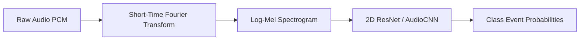

# Audio Event Detection & Environmental Sound Classification


An acoustic pattern recognition system recognizing environmental acoustic events (sirens, barking, machinery, gunshots, music) from audio streams.

## Audio Processing Pipeline


## Quick Test
```bash
python src/cli/audio_detect.py --class-sim 1
```
